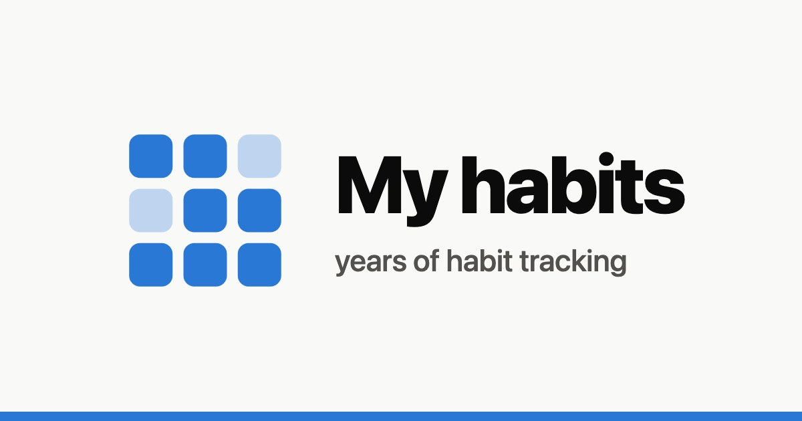

# My habits

Eleven habits tracked day by day since November 2017 with [Loop Habit Tracker](https://loophabits.org/): languages (Duolingo, Anki, sign language), lectures, books, drawing, exercise, programming, genealogy and more, on one page.

**Live:** https://sacret.github.io/habits/

[](https://sacret.github.io/habits/)

## What's on the page

- Summary tiles: check-ins (with change vs the previous year), share of days on track, strongest habit, longest streak, perfect days
- Daily check-ins calendar, one row and colour per year
- Every habit on one grid: share of days on track by month (or by week within a year)
- Check-ins over time, by year/month and by weekday
- Habit strength (Loop's score) for each habit
- Check-ins by habit, records, a habits table and a table with check-ins per habit by year/month

Pick a year with the tabs at the top or the ← / → keys. Every view works in light and dark mode and on phones.

## How it's built

```
Loop Habits CSV/      the app's export (Settings → Export as CSV)
  └─ scripts/normalize.py   →  data/habits.csv, data/<year>/{checkmarks,scores}.csv
      └─ scripts/build_page.py   →  index.html   (template: scripts/page.html)
          └─ scripts/make_og_image.py   →  og-image.jpg
scripts/make_icons.py   →  icons/
```

- **`scripts/normalize.py`** reads the per-habit files of the export, cuts off the days Loop fills in ahead of the export date, and writes one tidy format. Columns are documented in [`data/README.md`](data/README.md).
- **`scripts/build_page.py`** reads `data/` and embeds it into a single `index.html`, with hand-written SVG charts and no libraries. The look is shared with [activity](https://github.com/Sacret/activity).
- **`scripts/make_og_image.py`** draws the social preview card (favicon, title, a blue bar) with `scripts/og_card.py` and headless Google Chrome.

Only the Python standard library is needed, plus [Pillow](https://pypi.org/project/pillow/) for `make_icons.py` and Google Chrome for `make_og_image.py`.

## Updating

```sh
# replace "Loop Habits CSV/" with a fresh export, then
python3 scripts/normalize.py
python3 scripts/build_page.py
git add -A && git commit -m "Update data" && git push   # GitHub Pages redeploys from master
```

## Notes on the data

- A **check-in** is a day marked done in the app.
- A habit is **on track** on a day when it's done, or when Loop fills the day in because the week's or month's target is already met. With "twice a week", two check-ins cover the rest of that week. This is also how Loop counts streaks.
- **Strength** is Loop's habit score, 0–100%: it grows with every check-in and fades with every miss.
- Days before a habit was started don't count against it.

## Credits

Made by [Anastasia Abakumova](https://sacret.ru/) and [Claude Code](https://claude.com/claude-code). The data belongs to Anastasia.
